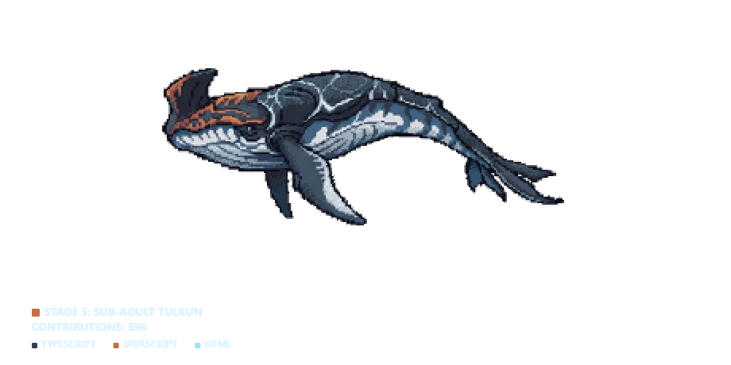

## Pathum Sandeepa | Full-Stack Developer

**FULL-STACK DEVELOPMENT | SYSTEMS ARCHITECTURE | OPEN SOURCE | UI ENGINEERING**

🧑‍💻 Aspiring Developer | 🎓 Computer Science Student | 🌐 Sharing my coding adventures.

Explore my tech stack and live cybernetic profile creature below.

  
  
  
  
  
  
  
  
  
  
  
  
  
  
  
  
  
  
  
  
  
  
  
  
  
  
  
  

  
  

<!-- CYBER-CREATURE:START -->

  

<!-- CYBER-CREATURE:END -->