## Pathum Sandeepa | Creative Builder

**FULL-STACK PLATFORMS | CREATIVE CODING | SCALABLE SYSTEMS | UI/UX DESIGN**

I'm @PathumSandeepa, a software engineer and creative builder sitting at the intersection of systems engineering and visual craft. I love building open-source developer tools, generative SVG engines, and scalable web applications.

Curious to see what I've been building? Explore my stack & live cybernetic guardian below.

  
  
  
  
  
  
  
  
  
  
  
  
  
  
  
  
  
  
  

  
  

<!-- CYBER-CREATURE:START -->

  

Live Cyber-Tulkun for @PathumSandeepa — Stage 4: APEX · 1,680 commits · View: SIDE

<!-- CYBER-CREATURE:END -->